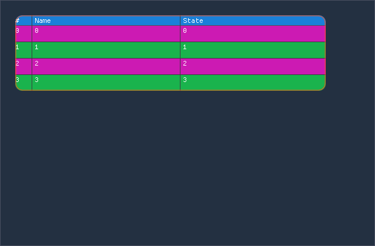
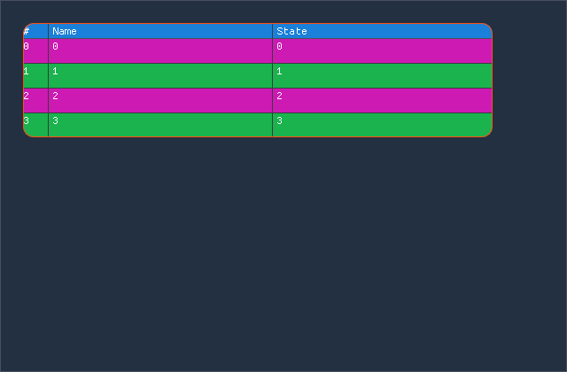

# Rounded table surfaces

`TableSurfaceGeometry` belongs to the table caller. Save the effective host
clip before `BeginTable` installs column clips. Use the table's own inner
window draw list, never a foreground list. Draw the background before rows,
then merge table channels with `EndTable` before drawing corner covers and
the outer border. Refresh decoration bounds from the final table rectangle:
non-scrolling tables can grow beyond their requested minimum height.

The border uses a stroke centre inset by half its thickness. It uses `PathRect`
and `PathStroke` directly: `AddRect` adds another half-pixel inset and divides a
one-pixel edge between two translucent pixel rows. Geometry-based line AA is
scoped to the border; later draw-list flags remain unchanged. Corner arcs use
Dear ImGui's adaptive subdivision rather than a fixed eight segments.

## Regression evidence

`test_table_surface_rendering` renders real resizable tables inside
`RoundedPanel` and samples the final `ImDrawData`, including command clipping,
triangle coverage, atlas alpha and textured line AA. Active checks cover opaque
border centres and pixels outside all four corner arcs at scales 1, 1.25, 1.5
and 2, with scrolling/non-scrolling tables, partial host clipping, and dark/light
parent surfaces. It does not substitute for checking application screenshots,
text readability, or interaction.

The new border-centre assertion fails against `f8dd4c6` with
`Table border has incomplete centre coverage`. The corrected implementation
passes in MinGW Debug and Release, in header-only and separately compiled
widget modes. Both images below are software rasterizations of final draw
data from the same real-table fixture, not hand-drawn mockups.

Before:

After:

